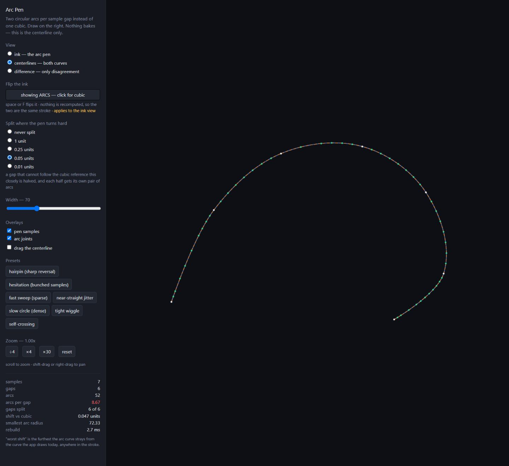

# Arc Pen Lab

Find how many circular arcs a smooth stroke actually needs.

## Why this exists

Before rebuilding the engine around circular arcs, the first question was whether they could preserve the feel and shape of the original cubic pen. A biarc is a pair of circular arcs joined smoothly. This lab lets the same pen samples drive both versions, then makes tiny differences visible.

It was built with AI assistance as part of [bound.less](https://bound-less-kk.web.app), Kobin Kempe’s infinite-zoom drawing project. The useful output was an experiment that could be inspected and compared in a real browser, helping decide what to build in the full application.

## Try it

[Open the live lab](https://kobin-ai-portfolio.kobinkempe.chatgpt.site/boundless-arc-pen-lab/) · [Read the case study](https://kobin-ai-portfolio.kobinkempe.chatgpt.site/case-studies/boundless-arc-pen-lab/)

1. Start with fast sweep, hairpin, or tight wiggle, or draw your own stroke.
2. Switch between ink, centerlines, and difference views.
3. Change the split tolerance from never split to a finer value.
4. Watch the arcs-per-gap count, show joints or samples, and drag sample points to test difficult turns.



## Run locally

The checked-in `dist/` is a standalone static site; it does not contact the original application or store drawings. Serve it with any static server, or use Node 18 or newer:

```sh
npm ci
npm run build
npm run preview
```

Open `http://127.0.0.1:4400`. Drawings and controls exist only in this page’s memory and reset on refresh. No API key or account is needed.

## What the experiment can tell you

This is a centerline experiment, not a perimeter bake or the full infinite canvas. Difference pixels are a thresholded visual diagnostic at the current zoom, not a mathematical error bound.

## Source and history

Recovered from [`src/Pages/ArcPen.js` at commit `f92c1d1`](https://github.com/kobinkempe/bound.less-kk/blob/f92c1d1bc274716c0351591122b41f1502a3a590/src/Pages/ArcPen.js) (26 August 2026). The development routes were removed in cleanup commit `f6f1062` on 1 September 2026. The algorithms and their local geometry dependencies come from the same historical revision so later engine changes cannot silently alter this comparison. `PROVENANCE.json` records the original source hashes and the small portfolio adaptations.

This is a historical research instrument. The current application has continued to evolve. No general speedup or production correctness claim follows from one preset or browser timing.

## Dependencies

React, React DOM, Scheduler, Object Assign and Clipper are bundled into the static build. Their copyright and license notices, including the Boost and JSBN terms used by Clipper, are included in [THIRD_PARTY_NOTICES.md](THIRD_PARTY_NOTICES.md). The `private` package setting prevents accidental publication to npm; it does not control GitHub visibility.
